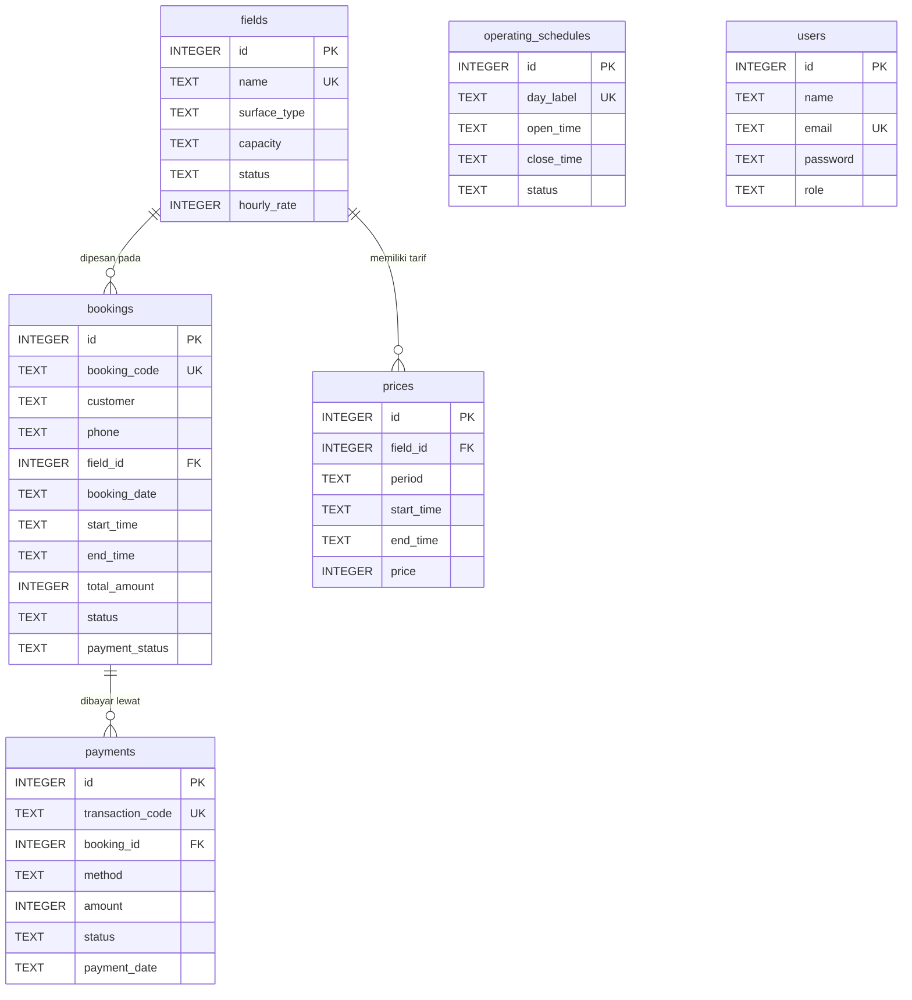

# Data Model MJBCourt

Dokumen ini berisi diagram relasi, kamus data, serta skema SQL, data contoh, dan query yang dipakai aplikasi (SQLite).

## Diagram relasi (ERD)



Tabel `operating_schedules` dan `users` berdiri sendiri, tidak memiliki relasi ke tabel lain.

## Kamus data

### fields

| Kolom | Tipe | Aturan | Keterangan |
|---|---|---|---|
| id | INTEGER | PK, auto increment | Identitas lapangan |
| name | TEXT | Wajib, unik | Nama lapangan |
| surface_type | TEXT | Wajib | Jenis permukaan (Vinyl, Rumput Sintetis, Interlock) |
| capacity | TEXT | Default `5 vs 5` | Kapasitas pemain |
| status | TEXT | `Aktif` atau `Perawatan`, default `Aktif` | Lapangan `Perawatan` tidak bisa dipesan |
| hourly_rate | INTEGER | Minimal 0 | Tarif per jam bawaan lapangan |
| created_at, updated_at | TEXT | Default waktu saat ini | Waktu dibuat dan diubah |

### operating_schedules

| Kolom | Tipe | Aturan | Keterangan |
|---|---|---|---|
| id | INTEGER | PK | Identitas jadwal |
| day_label | TEXT | Wajib, unik | Label hari (misalnya `Senin - Jumat`) |
| open_time, close_time | TEXT | Wajib | Jam buka dan tutup (`HH:MM`) |
| status | TEXT | `Buka` atau `Tutup` | Status operasional |

### bookings

| Kolom | Tipe | Aturan | Keterangan |
|---|---|---|---|
| id | INTEGER | PK | Identitas booking |
| booking_code | TEXT | Wajib, unik | Kode booking (misalnya `BK-001`) |
| customer, phone | TEXT | Wajib | Nama dan nomor telepon pemesan |
| field_id | INTEGER | FK ke `fields.id`, `ON DELETE RESTRICT` | Lapangan yang dipesan |
| booking_date | TEXT | Wajib | Tanggal main (`YYYY-MM-DD`) |
| start_time, end_time | TEXT | Wajib | Jam mulai dan selesai (`HH:MM`) |
| total_amount | INTEGER | Minimal 0 | Total harga hasil perhitungan tarif |
| status | TEXT | `Menunggu`, `Dikonfirmasi`, `Dibatalkan` | Status pemesanan |
| payment_status | TEXT | `Menunggu`, `Lunas`, `Refund` | Ringkasan status pembayaran |

### payments

| Kolom | Tipe | Aturan | Keterangan |
|---|---|---|---|
| id | INTEGER | PK | Identitas pembayaran |
| transaction_code | TEXT | Wajib, unik | Kode transaksi (misalnya `TRX-001`) |
| booking_id | INTEGER | FK ke `bookings.id`, `ON DELETE CASCADE` | Booking yang dibayar |
| method | TEXT | Default `Transfer Bank` | Metode pembayaran (misalnya `QRIS`) |
| amount | INTEGER | Minimal 0 | Nominal pembayaran |
| status | TEXT | `Menunggu`, `Terverifikasi`, `Refund` | Hanya `Terverifikasi` dihitung sebagai pendapatan |
| payment_date | TEXT | Default tanggal hari ini | Tanggal pembayaran |

### prices

| Kolom | Tipe | Aturan | Keterangan |
|---|---|---|---|
| id | INTEGER | PK | Identitas tarif |
| field_id | INTEGER | FK ke `fields.id`, `ON DELETE CASCADE` | Lapangan pemilik tarif |
| period | TEXT | Wajib | `Weekday`, `Weekend`, atau `Semua Hari` |
| start_time, end_time | TEXT | Wajib | Rentang jam berlakunya tarif |
| price | INTEGER | Minimal 0 | Harga per jam pada rentang tersebut |

### users

| Kolom | Tipe | Aturan | Keterangan |
|---|---|---|---|
| id | INTEGER | PK | Identitas pengguna |
| name | TEXT | Wajib | Nama pengelola |
| email | TEXT | Wajib, unik | Dipakai untuk login |
| password | TEXT | Wajib | Hash bcrypt, bukan teks asli |
| role | TEXT | `admin` atau `staff`, default `admin` | Peran (hak akses berbeda belum diterapkan) |

## Aturan relasi

| Relasi | Aturan saat data induk dihapus |
|---|---|
| `bookings.field_id` ke `fields.id` | Ditolak jika lapangan masih punya booking (`RESTRICT`) |
| `prices.field_id` ke `fields.id` | Tarif ikut terhapus (`CASCADE`) |
| `payments.booking_id` ke `bookings.id` | Pembayaran ikut terhapus (`CASCADE`) |

Semua relasi juga memakai `ON UPDATE CASCADE`. Relasi hanya ditegakkan jika `PRAGMA foreign_keys = ON` aktif pada koneksi.

## Catatan data contoh

- Data contoh booking memakai tanggal 6 dan 7 November 2026. Karena aplikasi menolak jadwal yang sudah lewat, data ini hanya untuk demo dan tidak bisa dibuat ulang lewat aplikasi setelah tanggalnya lewat.
- Query pada bagian 3 menulis nilai contoh langsung (misalnya `field_id = 1`). Di aplikasi, nilai tersebut dikirim sebagai parameter.
- Kode booking dan kode transaksi yang dibuat aplikasi dihasilkan otomatis dengan format yang lebih panjang dari contoh (`BK-001`, `TRX-001`). Contoh hanya untuk data awal.
- Akun admin tidak ada di data contoh. Buat lewat halaman daftar karena password harus berupa hash bcrypt.

## Skema SQL, data contoh, dan query

```sql
-- ============================================================

-- MJBCourt - Data model (SQLite)

-- Bagian 1: DDL (membuat tabel), sesuai init.sql

-- Bagian 2: DML contoh (isi data awal)

-- Bagian 3: Query yang dipakai aplikasi
-- ============================================================

PRAGMA foreign_keys = ON;

-- ------------------------------------------------------------
-- BAGIAN 1: DDL
-- ------------------------------------------------------------

CREATE TABLE IF NOT EXISTS fields (
    id INTEGER PRIMARY KEY AUTOINCREMENT,
    name TEXT NOT NULL UNIQUE,
    surface_type TEXT NOT NULL,
    capacity TEXT NOT NULL DEFAULT '5 vs 5',
    status TEXT NOT NULL DEFAULT 'Aktif' CHECK (status IN ('Aktif', 'Perawatan')),
    hourly_rate INTEGER NOT NULL DEFAULT 0 CHECK (hourly_rate >= 0),
    created_at TEXT NOT NULL DEFAULT CURRENT_TIMESTAMP,
    updated_at TEXT NOT NULL DEFAULT CURRENT_TIMESTAMP
);

CREATE TABLE IF NOT EXISTS operating_schedules (
    id INTEGER PRIMARY KEY AUTOINCREMENT,
    day_label TEXT NOT NULL UNIQUE,
    open_time TEXT NOT NULL,
    close_time TEXT NOT NULL,
    status TEXT NOT NULL DEFAULT 'Buka' CHECK (status IN ('Buka', 'Tutup')),
    created_at TEXT NOT NULL DEFAULT CURRENT_TIMESTAMP
);

CREATE TABLE IF NOT EXISTS bookings (
    id INTEGER PRIMARY KEY AUTOINCREMENT,
    booking_code TEXT NOT NULL UNIQUE,
    customer TEXT NOT NULL,
    phone TEXT NOT NULL,
    field_id INTEGER NOT NULL REFERENCES fields(id) ON UPDATE CASCADE ON DELETE RESTRICT,
    booking_date TEXT NOT NULL,
    start_time TEXT NOT NULL,
    end_time TEXT NOT NULL,
    total_amount INTEGER NOT NULL DEFAULT 0 CHECK (total_amount >= 0),
    status TEXT NOT NULL DEFAULT 'Menunggu' CHECK (status IN ('Menunggu', 'Dikonfirmasi', 'Dibatalkan')),
    payment_status TEXT NOT NULL DEFAULT 'Menunggu' CHECK (payment_status IN ('Menunggu', 'Lunas', 'Refund')),
    created_at TEXT NOT NULL DEFAULT CURRENT_TIMESTAMP,
    updated_at TEXT NOT NULL DEFAULT CURRENT_TIMESTAMP
);

CREATE TABLE IF NOT EXISTS payments (
    id INTEGER PRIMARY KEY AUTOINCREMENT,
    transaction_code TEXT NOT NULL UNIQUE,
    booking_id INTEGER NOT NULL REFERENCES bookings(id) ON UPDATE CASCADE ON DELETE CASCADE,
    method TEXT NOT NULL DEFAULT 'Transfer Bank',
    amount INTEGER NOT NULL DEFAULT 0 CHECK (amount >= 0),
    status TEXT NOT NULL DEFAULT 'Menunggu' CHECK (status IN ('Menunggu', 'Terverifikasi', 'Refund')),
    payment_date TEXT NOT NULL DEFAULT (date('now', 'localtime')),
    created_at TEXT NOT NULL DEFAULT CURRENT_TIMESTAMP
);

CREATE TABLE IF NOT EXISTS prices (
    id INTEGER PRIMARY KEY AUTOINCREMENT,
    field_id INTEGER NOT NULL REFERENCES fields(id) ON UPDATE CASCADE ON DELETE CASCADE,
    period TEXT NOT NULL,
    start_time TEXT NOT NULL,
    end_time TEXT NOT NULL,
    price INTEGER NOT NULL CHECK (price >= 0),
    created_at TEXT NOT NULL DEFAULT CURRENT_TIMESTAMP
);

CREATE TABLE IF NOT EXISTS users (
    id INTEGER PRIMARY KEY AUTOINCREMENT,
    name TEXT NOT NULL,
    email TEXT NOT NULL UNIQUE,
    password TEXT NOT NULL,
    role TEXT NOT NULL DEFAULT 'admin'
        CHECK (role IN ('admin', 'staff')),
    created_at TEXT NOT NULL DEFAULT CURRENT_TIMESTAMP
);

-- ------------------------------------------------------------
-- BAGIAN 2: DML contoh (isi data awal)
-- ------------------------------------------------------------

-- Lapangan
INSERT OR IGNORE INTO fields (id, name, surface_type, capacity, status, hourly_rate) VALUES
    (1, 'Lapangan A', 'Vinyl', '5 vs 5', 'Aktif', 120000),
    (2, 'Lapangan B', 'Rumput Sintetis', '5 vs 5', 'Aktif', 150000),
    (3, 'Lapangan C', 'Interlock', '7 vs 7', 'Perawatan', 180000);

-- Jam operasional
INSERT OR IGNORE INTO operating_schedules (day_label, open_time, close_time, status) VALUES
    ('Senin - Jumat', '08:00', '23:00', 'Buka'),
    ('Sabtu - Minggu', '07:00', '23:00', 'Buka');

-- Tarif
INSERT INTO prices (field_id, period, start_time, end_time, price) VALUES
    (1, 'Weekday',    '08:00', '17:00', 120000),
    (1, 'Weekday',    '17:00', '23:00', 120000),
    (1, 'Weekend',    '07:00', '17:00', 120000),
    (1, 'Weekend',    '17:00', '23:00', 150000),
    (2, 'Semua Hari', '08:00', '23:00', 150000),
    (3, 'Weekday',    '08:00', '23:00', 180000),
    (3, 'Weekend',    '07:00', '23:00', 180000);

-- Booking contoh
INSERT OR IGNORE INTO bookings
    (booking_code, customer, phone, field_id, booking_date,
     start_time, end_time, total_amount, status, payment_status) VALUES
    ('BK-001', 'Nathan', '089766543534', 1, '2026-11-06', '18:00', '19:00', 120000, 'Dikonfirmasi', 'Lunas'),
    ('BK-002', 'Budi',   '081234567890', 2, '2026-11-06', '19:00', '20:00', 150000, 'Menunggu',     'Menunggu'),
    ('BK-003', 'Sinta',  '082233445566', 1, '2026-11-07', '10:00', '12:00', 240000, 'Dibatalkan',   'Refund');

-- Pembayaran contoh (nominal diambil dari total booking)
INSERT OR IGNORE INTO payments (transaction_code, booking_id, method, amount, status)
SELECT 'TRX-001', id, 'Transfer Bank', total_amount, 'Terverifikasi' FROM bookings WHERE booking_code = 'BK-001';
INSERT OR IGNORE INTO payments (transaction_code, booking_id, method, amount, status)
SELECT 'TRX-002', id, 'QRIS', total_amount, 'Menunggu' FROM bookings WHERE booking_code = 'BK-002';
INSERT OR IGNORE INTO payments (transaction_code, booking_id, method, amount, status)
SELECT 'TRX-003', id, 'Transfer Bank', total_amount, 'Refund' FROM bookings WHERE booking_code = 'BK-003';

-- Akun admin dibuat lewat aplikasi atau script (password harus berupa hash bcrypt):

-- INSERT INTO users (name, email, password) 

-- ------------------------------------------------------------
-- BAGIAN 3: Query yang dipakai aplikasi
-- ------------------------------------------------------------

-- 3.1 Login: cari user berdasarkan email
SELECT * FROM users WHERE email = 'masukkan email admin yang sudah di daftar';

-- 3.2 Profil akun yang sedang login
SELECT id, name, email, role FROM users WHERE id = 1;

-- 3.3 Daftar lapangan
SELECT * FROM fields ORDER BY id ASC;

-- 3.4 Daftar jam operasional
SELECT * FROM operating_schedules;

-- 3.5 Daftar tarif beserta nama lapangan
SELECT p.*, f.name AS field_name
FROM prices p
JOIN fields f ON f.id = p.field_id
ORDER BY p.field_id ASC, p.period ASC;

-- 3.6 Tarif yang berlaku untuk lapangan pada periode tertentu (Weekday/Weekend)
SELECT *
FROM prices
WHERE field_id = 1
  AND (period = 'Weekday' OR period = 'Semua Hari')
ORDER BY start_time ASC;

-- 3.7 Cek tarif tumpang tindih sebelum menyimpan tarif baru
SELECT *
FROM prices
WHERE field_id = 1
  AND (period = 'Weekday' OR period = 'Semua Hari' OR 'Weekday' = 'Semua Hari')
  AND start_time < '23:00'
  AND end_time   > '08:00'
LIMIT 1;

-- 3.8 Daftar booking beserta nama lapangan
SELECT b.*, f.name AS field_name
FROM bookings b
JOIN fields f ON f.id = b.field_id
ORDER BY b.booking_date DESC, b.start_time ASC;

-- 3.9 Cek jadwal bentrok pada lapangan dan tanggal yang sama
--     (booking Dibatalkan tidak dihitung)
SELECT id, booking_code, start_time, end_time
FROM bookings
WHERE field_id = 1
  AND booking_date = '2026-11-06'
  AND status != 'Dibatalkan'
  AND start_time < '19:00'
  AND end_time   > '18:00'
LIMIT 1;

-- 3.10 Tambah booking
INSERT INTO bookings
    (booking_code, customer, phone, field_id, booking_date,
     start_time, end_time, total_amount, status, payment_status)
VALUES
    ('BK-004', 'Rina', '081111222333', 1, '2026-11-08',
     '17:00', '19:00', 240000, 'Menunggu', 'Menunggu');

-- 3.11 Konfirmasi atau batalkan booking
UPDATE bookings
SET status = 'Dikonfirmasi', updated_at = CURRENT_TIMESTAMP
WHERE id = 2;

-- 3.12 Verifikasi pembayaran
UPDATE payments SET status = 'Terverifikasi' WHERE id = 2;

-- 3.13 Daftar pembayaran beserta data booking
SELECT pay.*, b.booking_code, b.customer
FROM payments pay
JOIN bookings b ON b.id = pay.booking_id
ORDER BY pay.id DESC;

-- 3.14 Ringkasan dashboard dan laporan
SELECT COUNT(*) AS field_count FROM fields;

SELECT COUNT(*) AS bookings_today
FROM bookings
WHERE booking_date = '2026-11-06' AND status != 'Dibatalkan';

SELECT COUNT(*) AS pending_bookings FROM bookings WHERE status = 'Menunggu';

SELECT COALESCE(SUM(amount), 0) AS verified_revenue
FROM payments
WHERE status = 'Terverifikasi';

-- Jumlah booking per status
SELECT status, COUNT(*) AS total
FROM bookings
GROUP BY status;

-- 3.15 Pendapatan per lapangan (pembayaran terverifikasi)
SELECT f.name, SUM(pay.amount) AS pendapatan
FROM payments pay
JOIN bookings b ON b.id = pay.booking_id
JOIN fields f   ON f.id = b.field_id
WHERE pay.status = 'Terverifikasi'
GROUP BY f.id
ORDER BY pendapatan DESC;

-- 3.16 Hapus data
DELETE FROM bookings WHERE id = 4;
DELETE FROM prices   WHERE id = 1;
```